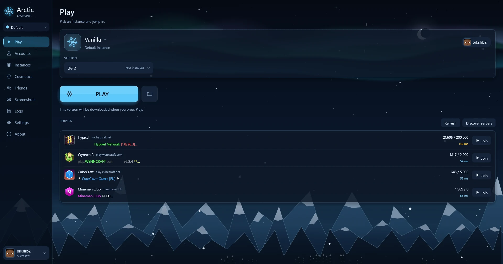
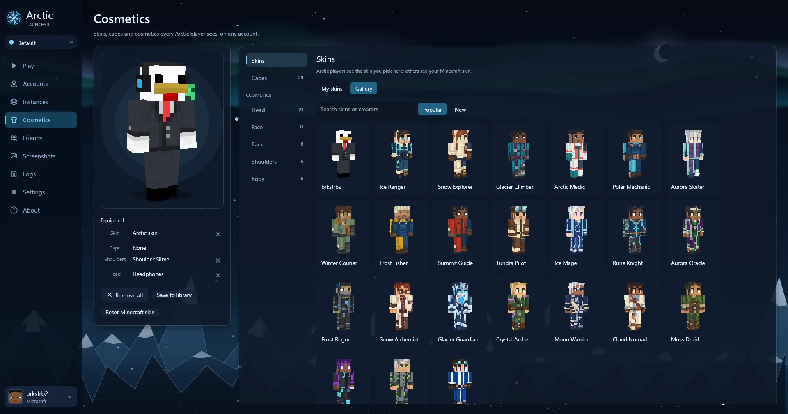

<p align="center">
  
</p>

<h1 align="center">Arctic Launcher</h1>

<p align="center">
  A Minecraft launcher with the Arctic Client built in.<br>
  The launcher runs every release, with mod loaders, mods, modpacks, accounts, servers and friends.<br>
  The client adds 128 built-in mods, including 53 HUD widgets, plus Polarium, replays, cosmetics and voice.
</p>

<p align="center">
  Arctic Client has no cheats and isn't related to other projects named Arctic.
</p>

<p align="center">
  <a href="https://github.com/brksfrb/arctic-launcher/releases/latest"></a>
  <a href="https://github.com/brksfrb/arctic-launcher/actions/workflows/ci.yml"></a>
  <a href="LICENSE"></a>
  
</p>

<p align="center">
  <a href="https://github.com/brksfrb/arctic-launcher/releases/latest"><b>Download</b></a> ·
  <a href="https://arcticlauncher.com">Website</a> ·
  <a href="docs/cli.md">Command line</a> ·
  <a href="https://arcticlauncher.com/support">Support</a>
</p>

<p align="center">
  <a href="https://flashhosting.net">Supported by&nbsp;<picture><source media="(prefers-color-scheme: dark)" srcset="docs/assets/flash-hosting-light.svg"></picture>&nbsp;<b>Flash Hosting</b></a>
</p>

<p align="center">
  
</p>

## Why Arctic

Arctic is the launcher and the Arctic Client together. Parallel downloads, and low CPU use while you play, are one part of it.

Press Right Shift in game for the client menu. The client is on by default for Vanilla, and for Fabric and Quilt instances, from 1.8.9 through the current release (the builds are 1.8.9, 1.9.4, 1.10.2, 1.11.2, 1.12.2, 1.13.2, 1.14.4 and 1.15.2 onward). Forge has it on 1.8.9. Turn it off per instance, or pick pure vanilla during setup.

### Launcher

- **Every release.** Pick a version and press Play. Arctic downloads the game and the Java that version needs.
- **Mod loaders, mods and modpacks.** Fabric, Quilt, NeoForge and Forge instances. Search Modrinth and install mods with their dependencies, or install a modpack. Each instance keeps its own version, mods, worlds and Java settings. Move an instance to another Minecraft version and its mods come along (updated where Modrinth has a build, switched off where it does not).
- **Clashes before you play.** The same mod twice, a mod that breaks another, a missing or too-old requirement, a mod made for another version. Fix each in one click, or play anyway.
- **Import.** Arctic finds the Minecraft Launcher, Prism, PolyMC, MultiMC, the Modrinth App, CurseForge, ATLauncher, GDLauncher (current and old), TLauncher, SKlauncher, Lunar, Badlion, Feather, LabyMod, Fast Client and Silent Client, and copies instances, worlds, servers and settings. The originals stay. Import one world from a folder or a .zip, and back worlds up.
- **Servers.** The multiplayer screen on every version: drag to reorder, icons, MOTD, players and ping, LAN worlds, and Discover servers (a public list). Reconnect in one click, or turn on Auto Reconnect.
- **Bedrock Edition** on Windows, Release and Preview. Switch version (GDK builds from 1.21.120 on, and older UWP builds), import and export worlds (`.mcworld`), packs and add-ons (`.mcpack`, `.mcaddon`), back worlds up, and keep a server list with player counts and ping.
- **Accounts.** Microsoft sign-in in the browser or with a short code, or an offline account (any name) for singleplayer, LAN and offline-mode servers. Several accounts, switched in one click. Sign-ins stay on the PC, encrypted for that user, and go only to Microsoft and Mojang. Servers that check accounts still need a Microsoft account that owns Minecraft: Java Edition.
- **Profiles.** Separate accounts, settings, instances and worlds on one PC. Switch from the top of the sidebar.
- **Screenshots, logs and crashes.** Every instance's screenshots in one list. The game log inside the launcher, searchable, filterable by warnings or errors. A crash is explained in plain language and sent only if you allow it (ask each time, always, or never). Name, folders, sign-in details, e-mails and IP addresses are removed first.
- **SOCKS5 proxy** for the launcher and the game. With the Arctic Client, server connections go through it on Vanilla and Fabric instances. Otherwise only Minecraft's login does.
- **The app itself.** A native app, so it uses little CPU while you play. Downloads run in parallel, and a version that is already installed starts without downloading again. Themes are Aurora (an animated night with snowfall and shooting stars; it pauses while you play), Dark and Light. Discord status is optional. Updates install themselves after they are checked, and a short "What's new" follows (you can turn that off). The `arctic` command line launches versions and instances, installs mods and manages profiles, with JSON output for scripts. GPL-3.0.

### Client mods

The Mods screen on current versions lists **128 built-in mods, including 53 HUD widgets**: every tile `ModCatalog` shows there. 1.8.9 also has 1.7 Animations, which is not in that 128. A version with no hook for a mod leaves that tile off, so an older version can show fewer. The names below are those tiles, in the category the screen uses.

**Combat (6).** Combat Feedback (hit marker, hit and kill sounds, low-health warning), Attack Range Indicator, Hitboxes, Hit Color, TNT Timer, Low Durability.

**Movement (7).** Zoom, Freelook, Snaplook, Toggle Sprint, Toggle Sneak, Portal Screens, Controller (Xbox, PlayStation and other gamepads: walk, look, fight, hotbar, inventory, and a pointer on menus). Freelook stays off on servers that do not allow it.

**Inventory (5).** Lock Slots, Inventory Search (Ctrl+F), Client Sort, Pickup Display, Shulker Peek (shulker boxes and other containers that carry their contents).

**Visual (23).** Fullbright, Crosshair (shape, size, color, or your own picture), Time Changer, Clear Weather, Low Fire, Motion Blur, Item Physics, Block Outline, Glint Colorizer, Shiny Pots, 2D Items, Dynamic FOV, Fog, Mob Size, Hide Titles, Damage Tint, Scoreboard, Dynamic FPS, No Hurt Shake, Debug Screen (colored F3), Particle Control, Held Item, Packs & Shaders (resource packs and shaders from Modrinth, including from the in-game menu).

**Chat (7).** Chat (timestamps, stacked lines, mentions, `{x}` `{y}` `{z}` placeholders, mute), Chat History (search, filters, a second chat, longer scrollback), Emoji and Symbols, Quick Messages, Auto Text, Auto GG, Streamer Mode.

**Tools (7).** Waypoints, Screenshots (copy to the clipboard), Replays, Death Position, Confirm Leaving, Auto Reconnect, Quickplay (Hypixel `/play` groups: Bed Wars, SkyWars, Duels, Murder Mystery, TNT Games, Build Battle, Blitz SG, Mega Walls, Arcade, SkyBlock; other servers ignore commands they do not know).

**Players (7).** Tier Tags (PvPTiers or SubTiers, best tier or one mode, on the name tag and in the tab list, such as `HT3 Sword | Steve`), Ping Tags, Tab Ping, Find Me in Tab, Arctic Badge, Own Name Tag, OptiFine Capes (without OptiFine).

**Social (4).** Friends, Emotes, Auto LAN (opens your singleplayer world to LAN while you host in Play together: survival, no cheats), Team View (scoreboard teammates outlined through walls; a box on 1.8.9).

**Client (4).** Menu Style (Arctic, Aurora, Classic or Vanilla, plus the smooth font), Account (switch accounts, or the proxy), Command Palette (Ctrl+K: mods, servers, friends), Cosmetics Check.

**HUD (2, plus the 53 widgets).** Saturation Bar, HUD Style.

**No category chip (3).** Chunk Borders, Scrollable Tooltips, Sound Changer. They are on the Mods screen; the old Gameplay chip is gone.

Those groups are 75 tiles. With the 53 HUD widgets, that is 128.

### HUD widgets

These **53 HUD widgets** are part of the 128. Minimap, Cooldowns, Horse stats, Scoreboard and Boss bar are the ones a version can omit. Four looks, named Arctic, Clean, Minimal and Rainbow, apply to every widget at once. Widgets line up on their own and snap when you move them. The server scoreboard and boss bar move, resize and hide the same way.

**Performance (13).** FPS, Ping, TPS, Frame time, 1% low, CPU, PC CPU, PC RAM, Alloc, GPU, VRAM, Memory, Entities.

**PvP (12).** CPS, Keystrokes, Armor, Effects, Arrows, Items, Held item, Pearl, Block, Fall, Target, Cooldowns.

**World (16).** XYZ, Facing, Speed, Biome, Light, Chunk, Day, World time, Time, Date, Compass (waypoints on it), Minimap (square or round, north-up or turning with you, players and waypoints), Last death, Stopwatch, Looking at, Horse stats.

**Info (12).** Arctic watermark, Filtered chat, Server, Players, Session, Food, Pack, Move, Reach, Combo, Scoreboard, Boss bar.

### Performance

One switch, on by default, adds optimization mods from Modrinth for that Minecraft version: ModernFix, Sodium, Lithium, FerriteCore, ImmediatelyFast, EntityCulling, Particle Core and BadOptimizations. It applies to Vanilla (which runs on Fabric underneath) and to Fabric and Quilt instances, and it skips a mod you already have, or one that does the same job. A mod with no build for that version is skipped.

The same switch installs **Polarium** where the launcher has a build: 1.8.9 on Fabric, and 26.1.2, 26.2 and 26.3. Polarium draws entities on the GPU and spreads their work across CPU cores, for servers with a lot of players. Forge 1.8.9 uses Patcher and EntityCulling instead. Wavey Capes is a separate optional mod, not part of this set.

### Social

Add friends with a code. See who is online and which server they are on, invite them, and chat or send screenshots from the launcher or in game. Voice is proximity voice with other Arctic players on the same server (open mic or push to talk). It also speaks Simple Voice Chat's protocol, so you can talk on servers that run that plugin.

Play together opens your world to friends with a code. No server of your own and no port forwarding: the world is opened to LAN while you host, and friends connect directly, or through an encrypted relay when a direct link is not possible. Both of you need Arctic, the same Minecraft version and the same mods.

Duels start from the in-game Friends tab: a flat arena and a kit, shared through Play together. Your friend joins from the invite.

### Replays

The client keeps a rolling window of the game (30 seconds by default, up to 120). Save that clip, or start and stop a longer recording. Watch it in 3D from any angle, seek, or export a video. Recordings are compressed as they are written. The launcher lists them, and `arctic launch --replay` opens one. The replay mod is on the list only on versions that can record and play them back.

### Cosmetics

Skins from your library, or a copy of a player's skin by name. Capes from the shared list or your own image, including animated capes (those can be pinned to one frame). A 3D preview. Microsoft accounts can also change the skin Minecraft itself shows.

3D cosmetics, one per slot: Head, Face, Back, Shoulders, Arms, Body. You can nudge a face cosmetic and mirror a shoulder one. Emotes play from a wheel in game. Other Arctic players see the skin, cape, cosmetics and emote. Offline accounts get them too.

The skin gallery is skins other players shared. Search by name or creator, wear one, or share one from your library.

## Install

### Windows

1. Download **`arctic-launcher-windows-x64.exe`** from the
   [latest release](https://github.com/brksfrb/arctic-launcher/releases/latest).
2. Run it. There is no installer; put it wherever you like.

Windows may show a SmartScreen prompt for new apps. Choose **More info → Run anyway**.

### macOS

1. Download **`arctic-launcher-macos.zip`** from the
   [latest release](https://github.com/brksfrb/arctic-launcher/releases/latest) and unzip it.
2. Move **Arctic Launcher** to Applications and open it. It runs on Apple Silicon and Intel
   Macs.

The app isn't notarized by Apple yet, so the first time macOS asks: right-click the app,
choose **Open**, then **Open** again.

### Linux

For software-manager installation and updates, use the
[official Arctic Flatpak](https://brksfrb.github.io/arctic-launcher/). Download the
install file and open it with your software manager. Enable automatic updates there
if you want updates installed automatically. This supports x86_64 Linux.

For the standalone download:

1. Download **`arctic-launcher-linux-x64`** from the
   [latest release](https://github.com/brksfrb/arctic-launcher/releases/latest).
2. Make it executable and run it:

   ```sh
   chmod +x arctic-launcher-linux-x64
   ./arctic-launcher-linux-x64
   ```

Works on X11 and Wayland desktops with OpenGL.

### Command line tool (optional)

Grab `arctic-windows-x64.exe`, `arctic-macos` or `arctic-linux-x64` from the same release and put it on
your `PATH` as `arctic`. See the [command line guide](docs/cli.md).

## Getting started

The first time you open Arctic, a short setup picks your theme, account, memory and
first instance. After that:

1. On **Play**, pick a version or an instance. The picker shows which versions are
   already installed.
2. Press **Play**.

For mods, open **Instances**, create a Fabric instance and use **Browse mods**. To play
with friends, open **Play together**. Memory, window size, theme and more are under
**Settings**. To keep a separate setup,
for example for testing or family members, create a **profile** from the switcher under
the logo.

## Command line

```sh
arctic launch                          # latest release, active account
arctic launch 1.20.1 --account Alex --memory 6G
arctic launch latest --wait
arctic install 1.21.4                  # download only
arctic instances create "Fabric" --version 26.3 --loader fabric
arctic mods install sodium --instance fabric
arctic launch --instance fabric
arctic profiles create "Speedruns" --switch
arctic open --launch 1.21.4            # open the launcher and start playing
```

Everything also works with `--json` for scripts. Full reference:
[docs/cli.md](docs/cli.md).

## FAQ

**Where are my files?**
Windows: `%LOCALAPPDATA%\ArcticLauncher`. macOS: `~/Library/Application Support/ArcticLauncher`.
Linux: `~/.local/share/ArcticLauncher`.

The Flatpak uses `~/.var/app/com.arcticlauncher.ArcticLauncher/data/ArcticLauncher`.
Each profile lives in `profiles/<name>/`. Worlds are inside
`instances/vanilla/minecraft/saves`. `arctic paths` prints them all.

**Where are my sign-in details stored?**
Only on your computer, in your profile folder, encrypted so that only your user account on
that PC can read them (a copied file is useless elsewhere). They are sent only to Microsoft, Xbox and
Mojang to sign you in. Arctic's own service for looks never receives your password or
tokens: it checks who you are the same way a Minecraft server does.

**What does Arctic connect to?**
Mojang and Microsoft for the game and sign-in, Modrinth and the Fabric, Quilt, NeoForge
and Forge servers for mods and loaders, GitHub for updates, and the Arctic looks service,
which shares the skin and cape you picked with other Arctic players. Play together connects you directly to your friend, using a public
relay only to set that up or when a direct link fails.

**Does it need Java?**
No. Arctic downloads the official Java runtime each Minecraft version needs and keeps it
up to date.

**Mods?**
Yes. Create a Fabric, Quilt, NeoForge or Forge instance under **Instances** and browse
Modrinth from there. You can also drop `.jar` files into the instance's `mods` folder.

**Do my friends need Arctic to play together?**
Yes, both of you need Arctic Launcher, the same Minecraft version and the same mods.

**Is this an official Minecraft product?**
No. Arctic Launcher is an independent project, not approved by or associated with Mojang
or Microsoft.

<p align="center">
  
</p>

## Building from source

See [docs/building.md](docs/building.md). The architecture overview is in
[docs/architecture.md](docs/architecture.md).

Polarium, our mod for huge crowds of players (entities drawn on the GPU, their
work spread across CPU cores), lives in its own repository:
[brksfrb/polarium](https://github.com/brksfrb/polarium).

## Supported by

<a href="https://flashhosting.net"><picture><source media="(prefers-color-scheme: dark)" srcset="docs/assets/flash-hosting-light.svg"></picture></a>

Arctic is supported by **[Flash Hosting](https://flashhosting.net)**: Minecraft servers that stay up
24/7, priced by player slots, not gigabytes. Play together runs while you're online; Flash Hosting
keeps your world up when you're not.

<br clear="left">

## License

[GPL-3.0-or-later](LICENSE). "Minecraft" is a trademark of Mojang Synergies AB.
